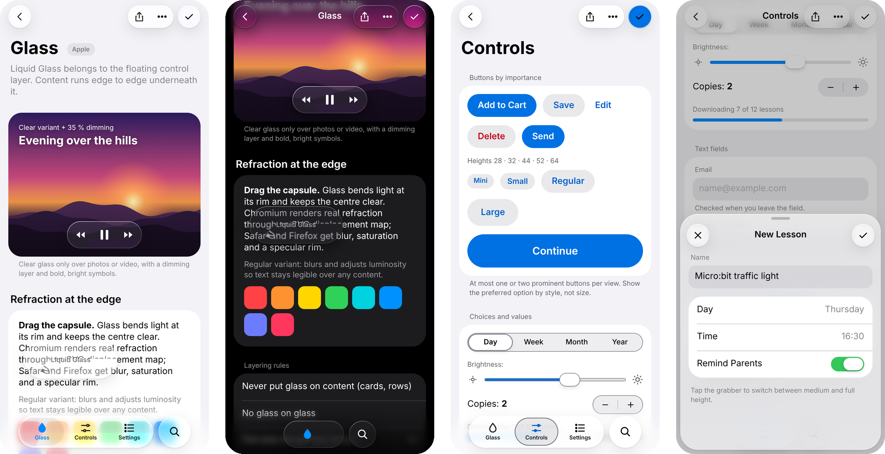
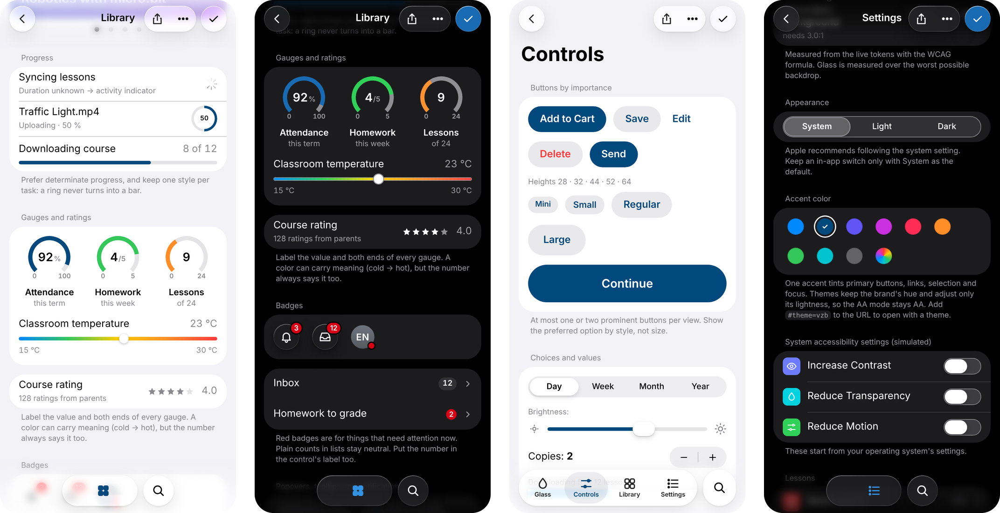
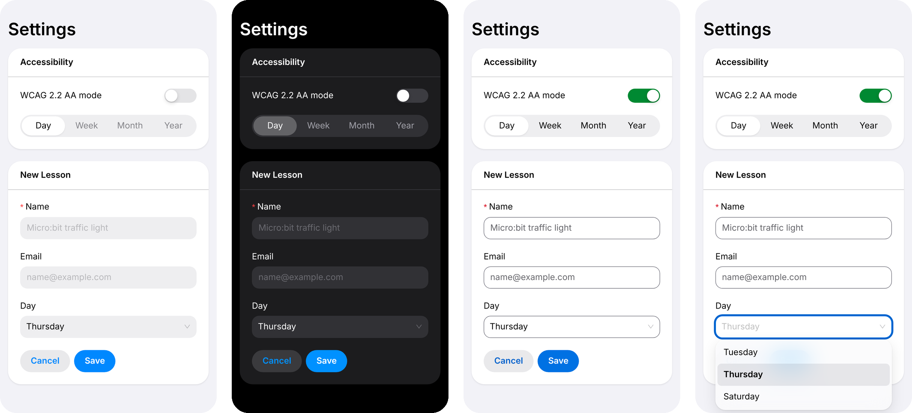
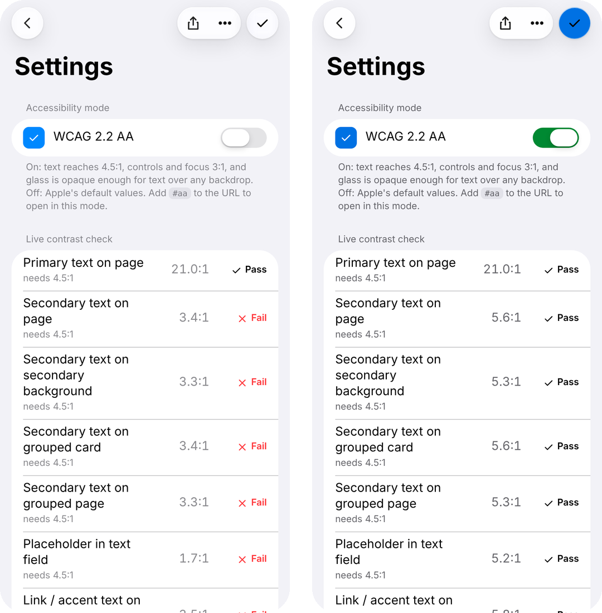
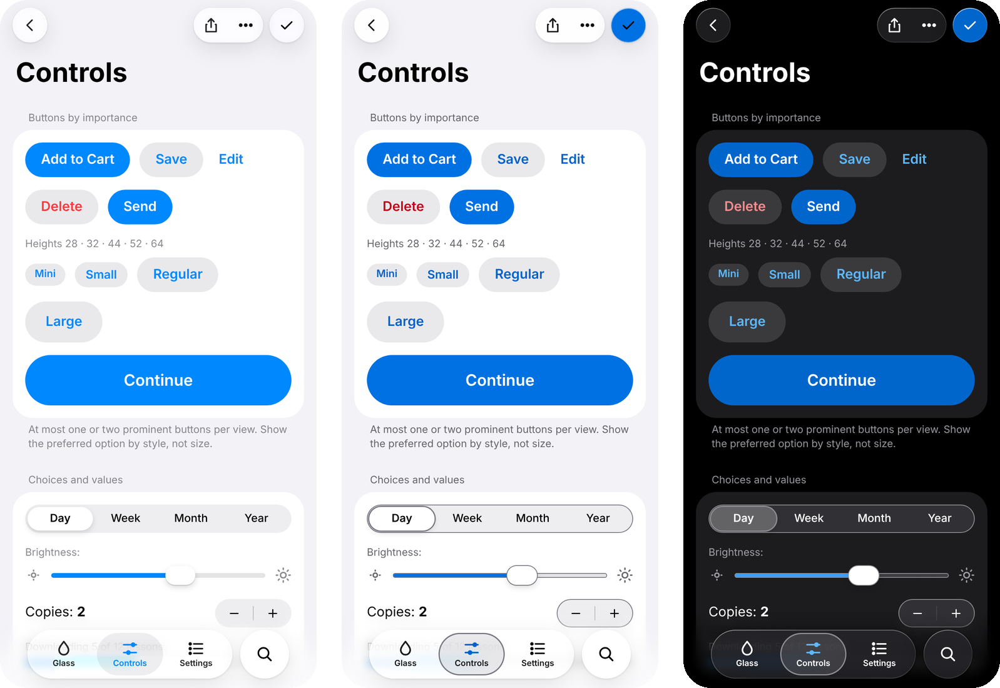
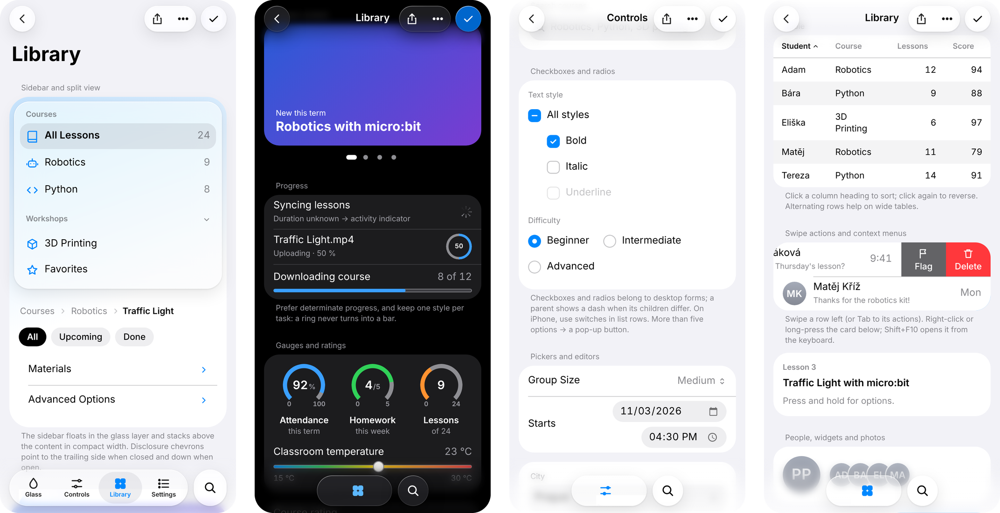
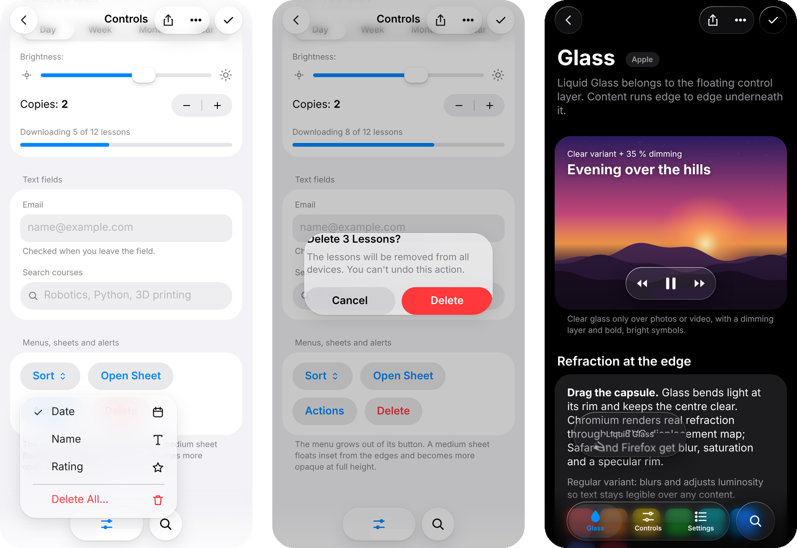
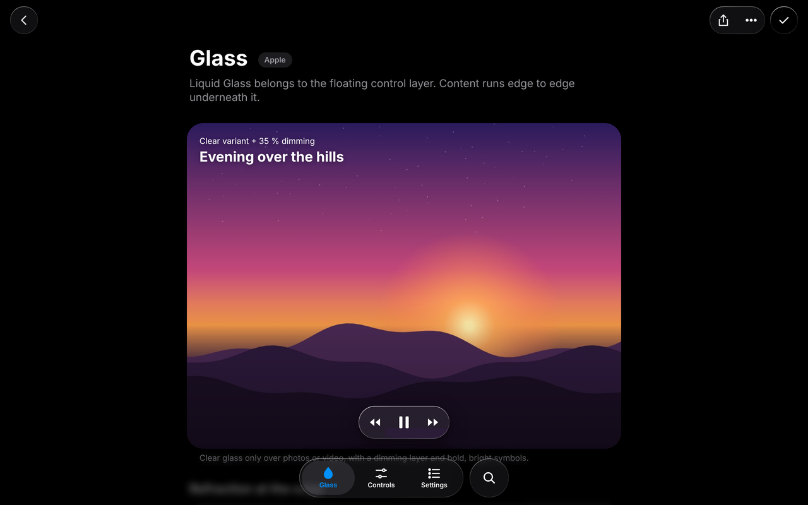

# hig-web-kit

Apple's Human Interface Guidelines and the Liquid Glass design language, packaged for the web. It works with any CSS approach or UI framework, and it has an opt-in **WCAG 2.2 AA mode**.

- **One token source, many outputs**: CSS custom properties, Sass, JS/TS, JSON, plus Tailwind (v3 and v4), shadcn/ui, Bootstrap 5, MUI and Ant Design adapters.
- **Two color modes**:
  - `apple`: Apple's own values (the default).
  - `aa`: every text pair meets 4.5:1, and every control boundary and focus indicator meets 3:1.

  Each mode comes in light, dark and increased-contrast variants, switched by OS settings or by attributes on `<html>`.
- **Accent themes**: built-in brand themes (including Vzdělání budoucnosti) and `applyBrandColor()` for any color, with AA-safe variants derived for every mode and scheme.
- **Liquid Glass**: CSS material classes. Optional JS adds real edge refraction (Chromium), lighting from the touch point, and a light/dark flip over dark content. Reduce Transparency, Increase Contrast and Reduce Motion are respected.
- **Framework-free components** (50+): see the [component list](#components) below.
- **Guidelines as a skill**: `skill/SKILL.md` condenses the HIG (layering, components, patterns, writing, accessibility) for designers and AI assistants.



> Not affiliated with or endorsed by Apple Inc. See [NOTICE.md](NOTICE.md). No Apple fonts, SF Symbols or other Apple assets are included.

**Demo:** open `dist/demo.html` after building, or add `#aa`, `#dark`, `#hc` (combinable: `#aa-dark-hc`) to the demo URL.

---

## Install

```bash
npm i hig-web-kit
```

Or copy the `dist/` folder. Everything in it is plain CSS/JS with no runtime dependencies.

## Quick start (any stack)

```html
<link rel="stylesheet" href="hig-web-kit/dist/hig.css">         <!-- tokens (required) -->
<link rel="stylesheet" href="hig-web-kit/dist/base.css">        <!-- optional page defaults -->
<link rel="stylesheet" href="hig-web-kit/dist/glass.css">       <!-- Liquid Glass material -->
<link rel="stylesheet" href="hig-web-kit/dist/components.css">  <!-- framework-free components -->
```

```css
.card { background: var(--hig-grouped-bg-2); color: var(--hig-label); border-radius: var(--hig-radius-card); }
.card p { color: var(--hig-label-2); font: var(--hig-text-subhead); }
```

### Modes and preferences

All state lives in attributes on `<html>`. With no attributes, the OS settings apply.

| Attribute | Values | Default |
|---|---|---|
| `data-hig-mode` | `aa` | Apple values |
| `data-hig-scheme` | `light` · `dark` | `prefers-color-scheme` |
| `data-hig-contrast` | `more` · `standard` | `prefers-contrast` |
| `data-hig-transparency` | `reduce` · `standard` | `prefers-reduced-transparency` |
| `data-hig-motion` | `reduce` · `standard` | `prefers-reduced-motion` |

```js
import { restorePreferences, setMode, watchPreferences } from 'hig-web-kit/a11y';
restorePreferences();             // saved choice + URL flags (#aa, #dark, #hc)
setMode('aa');                    // or 'apple'
watchPreferences(p => console.log(p)); // { mode, scheme, contrast, transparency, motion }
```

### Accent themes

```html
<html data-hig-theme="vzb">   <!-- vzb · indigo · purple · pink · orange · green · teal · graphite -->
```
```js
import { setTheme, applyBrandColor } from 'hig-web-kit/theme';
setTheme('vzb');               // or applyBrandColor('#c8102e') for any brand color
```

Themes keep the brand's hue and move only its lightness where needed, so the AA mode stays WCAG 2.2 AA with any brand. See [docs/themes.md](docs/themes.md).



## Framework guides

| Stack | Entry point | Guide |
|---|---|---|
| **Ant Design 5 / 6** | `hig-web-kit/antd` + `antd-glass.css` | [docs/frameworks/antd.md](docs/frameworks/antd.md) |
| Tailwind CSS 4 / 3 | `tailwind.css` / `tailwind-preset` | [docs/frameworks/tailwind.md](docs/frameworks/tailwind.md) |
| shadcn/ui | `shadcn.css` | [docs/frameworks/shadcn.md](docs/frameworks/shadcn.md) |
| MUI | `hig-web-kit/mui` | [docs/frameworks/mui.md](docs/frameworks/mui.md) |
| Bootstrap 5 | `hig-bootstrap.scss` + `bootstrap-runtime.css` | [docs/frameworks/bootstrap.md](docs/frameworks/bootstrap.md) |
| Vue, Svelte, Angular, plain HTML, anything else | `hig.css` + CSS variables, or `tokens.json` | [docs/frameworks/other.md](docs/frameworks/other.md) |

### Ant Design in 30 seconds

```tsx
import 'hig-web-kit/hig.css';
import 'hig-web-kit/glass.css';
import 'hig-web-kit/antd-glass.css';         // optional: glass dropdowns, popovers, modals
import { ConfigProvider } from 'antd';
import { higAntd } from 'hig-web-kit/antd';

<ConfigProvider {...higAntd({ mode: 'aa', scheme: 'dark', density: 'touch', accent: 'vzb' })}>
  <App />
</ConfigProvider>
```

A complete example that follows OS settings live is in [examples/antd/App.tsx](examples/antd/App.tsx).



<sub>Ant Design 6 with `higAntd()`. From left: Apple mode light, Apple mode dark, AA mode (outlined fields, darker green switch), AA mode with a glass Select dropdown.</sub>

## Accessibility: what the AA mode guarantees

`npm run check:contrast` measures every color pair with the WCAG formula (glass is measured over both a black and a white backdrop). CI fails if any `aa` set drops below AA. The `apple` sets are reported for information only, because several Apple defaults fall short:

| Pair | Apple light | AA light |
|---|---|---|
| Secondary text on page | 3.4:1 ✗ | 5.6:1 ✓ |
| Placeholder in field | 1.7:1 ✗ | 5.1:1 ✓ |
| Label on blue button | 3.5:1 ✗ | 4.7:1 ✓ |
| Switch "on" vs background | 2.2:1 ✗ | 4.54:1 ✓ |
| Field / switch-off boundary | none ✗ | 4.49:1 ✓ |
| Focus ring | 1.9:1 ✗ | 5.8:1 ✓ |



<sub>The demo's live contrast check (`checkContrast()`): Apple mode on the left, AA mode on the right.</sub>



<sub>Same controls: Apple mode, AA mode (visible field, segmented and stepper borders; darker blue), AA dark.</sub>

Color is only part of WCAG. The kit also provides:

- 44 px touch targets (24 px minimum per WCAG 2.5.8);
- `rem` type that scales to 200 %;
- visible `:focus-visible` rings, plus `scroll-padding` so floating bars never cover focus (2.4.11);
- keyboard support for segmented controls, tabs and menus;
- ARIA roles in the components;
- reduced motion and transparency handling.

Your own content, labels and flows still need review. See [docs/accessibility.md](docs/accessibility.md).

## Components

Plain HTML classes from `components.css`, with behaviour, keyboard support and ARIA from `initComponents()` in `hig-web-kit/components`.

| Group | Components |
|---|---|
| Actions | buttons (prominent, gray, plain, destructive; 5 sizes; busy state), icon buttons, toggle buttons |
| Choices and values | accent color picker, switch, segmented control, slider, stepper, checkbox and radio (mixed parent state), pop-up button, select, compact date/time picker |
| Text | text field with inline validation, search field, multiline field with counter, token field |
| Navigation | toolbar with glass groups, floating tab bar, sidebar, split view, page control, disclosure, scope bar and filter chips, path control |
| Menus and overlays | menu, context menu (right-click, long press, Shift+F10), popover (a sheet in compact width), tooltip, sheet, alert, action sheet |
| Status | linear and circular progress (with label), activity indicator, gauges with captions, rating, badges and neutral counts, empty state, skeleton, notification banner, HUD toast (`showToast()`) |
| Content | inset grouped list, swipe actions, sortable table, avatar and stack, card, widget, photo grid |



<sub>Left to right: sidebar, path control, scope bar and disclosure; page control, gauges and badges in AA dark mode; checkboxes, radios and pickers; sortable table and swipe actions.</sub>

## Liquid Glass

```html
<nav class="hig-glass hig-tabbar" data-hig-adapt data-hig-refract>…</nav>
<button class="hig-glass hig-glass--tint hig-icon-btn hig-press-scale" aria-label="Done">…</button>
<script type="module">
  import { initGlass } from 'hig-web-kit/glass';
  initGlass(); // refraction (Chromium only), touch light, light/dark adaptivity
</script>
```





Rules worth keeping: glass goes only on the floating layer (bars, menus, sheets), never on cards or rows; never put glass on glass; tint only the primary action. Details are in [docs/liquid-glass.md](docs/liquid-glass.md).

## Tokens

`tokens/tokens.json` is the single source. `npm run build` regenerates `dist/`. Names follow Apple's semantic colors: `label`, `label-2`, `bg`, `grouped-bg-2`, `fill-3`, `sep` and so on. See [docs/tokens.md](docs/tokens.md) for the full list and each value per mode.

## Development

```bash
npm install
npm run verify   # build → contrast check → tests (CSS cascade, antd, MUI, Tailwind, Sass) → typecheck
```

## License

[MIT](LICENSE). Apple, Liquid Glass, SF Pro and SF Symbols are trademarks of Apple Inc.; see [NOTICE.md](NOTICE.md).
